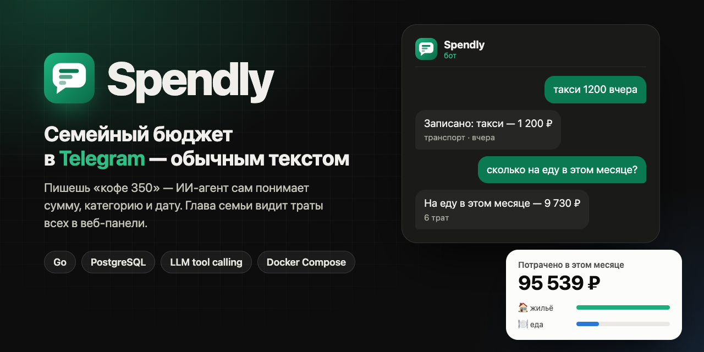
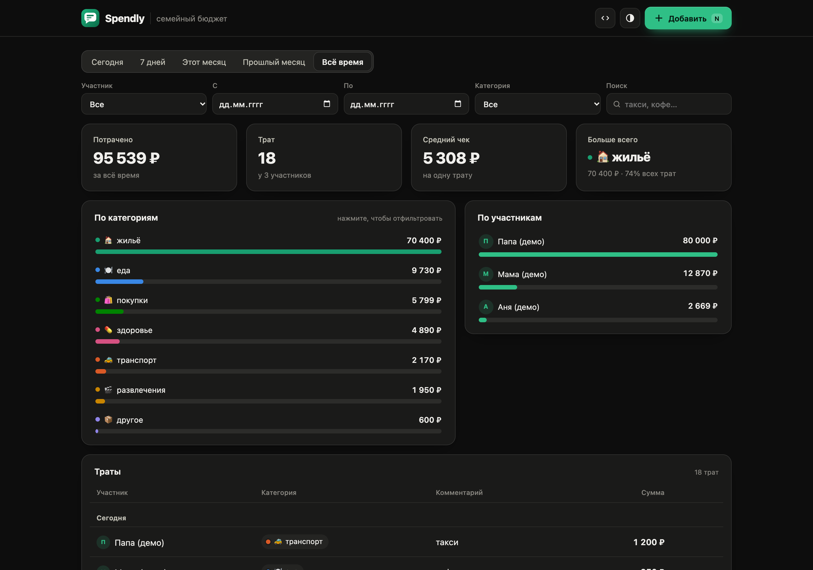
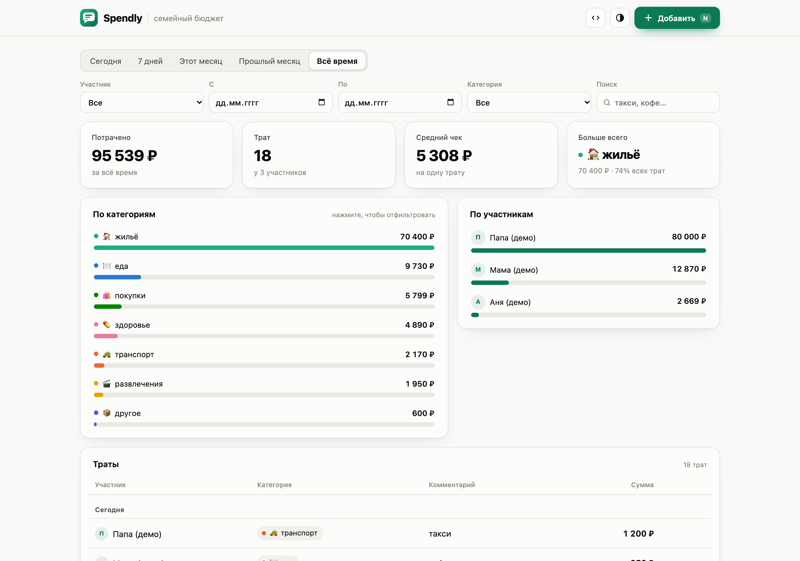
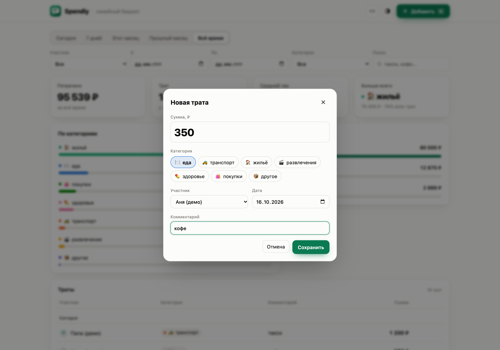
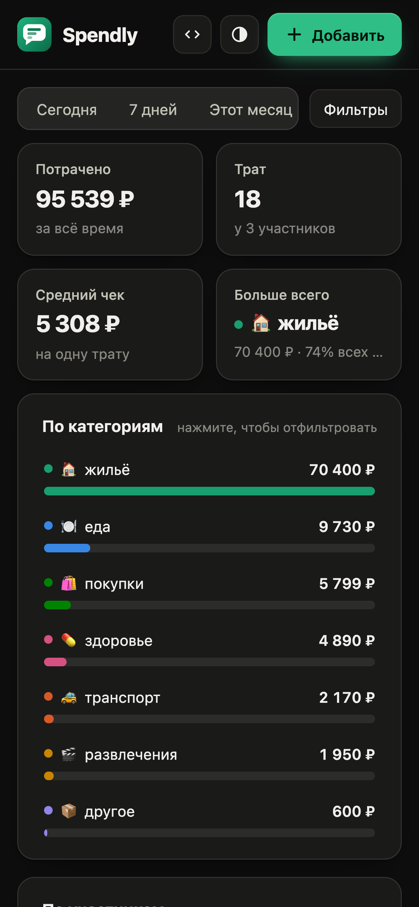
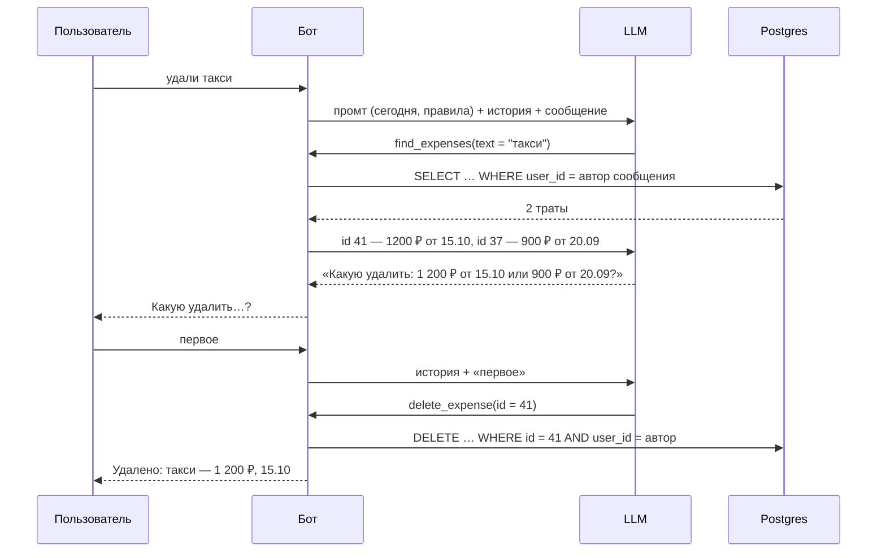
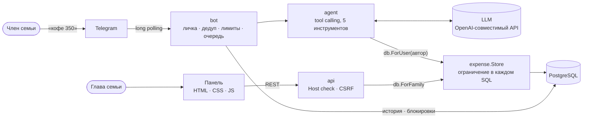

<p align="center">
  
</p>

<h1 align="center">Spendly</h1>

<p align="center">
  <b>Семейный бюджет в Telegram — обычным текстом.</b><br>
  Пишешь боту «кофе 350» — ИИ-агент сам понимает сумму, категорию и дату.<br>
  Глава семьи видит траты всех в веб-панели.
</p>

<p align="center">
  
  
  
  
  
  
</p>

<p align="center">
  <a href="#-быстрый-старт">Быстрый старт</a> ·
  <a href="#-соответствие-тз">Соответствие ТЗ</a> ·
  <a href="#-архитектура">Архитектура</a> ·
  <a href="#-качество">Качество</a> ·
  <a href="#-безопасность-и-приватность">Безопасность</a>
</p>

<p align="center">
  
</p>

---

## ✨ Что умеет

- **💬 Бот без кнопок и команд.** «кофе 350», «такси 1200 вчера», «сколько потратил на еду в этом месяце», «последнее было не 350, а 450», «удали такси» — агент сам вызывает нужные операции. Если не ясно, о какой трате речь, переспрашивает, а не угадывает.
- **🔒 Каждый видит только свои траты.** Изоляция обеспечивается кодом: агенту недоступны чужие данные, даже если модель попытается.
- **📊 Панель для главы семьи.** Итоги за период, разбивка по категориям и участникам, фильтры, добавление, правка и удаление с отменой. Тёмная и светлая темы, телефон.
- **🧪 Проверяемое качество.** Тесты на настоящем Postgres с `-race`, набор из 41 фразы для оценки агента на настоящей модели, CI.

## 🖥 Панель

| Тёмная тема | Светлая тема |
|---|---|
|  |  |

| Добавление траты | Телефон |
|---|---|
|  |  |

- Счётчики докручиваются до новых значений, полосы растут из нуля, строки появляются лесенкой, удаление можно отменить из уведомления. При `prefers-reduced-motion` анимации отключаются.
- Клик по полосе категории или участника — фильтр. `N` — новая трата, `/` — поиск.
- Цвета категорий — проверенная валидатором палитра: различимы при дальтонизме в обеих темах, у каждой полосы есть подпись, поэтому цвет никогда не единственный носитель смысла.

## 🚀 Быстрый старт

```bash
make up
```

Это `cp .env.example .env && docker compose up --build`: Postgres → разовые миграции → приложение.

- Панель: **http://localhost:8080** — сразу с демо-семьёй.
- Документация API: **http://localhost:8080/docs**.

Для бота нужны два значения в `.env`: `TELEGRAM_TOKEN` от [@BotFather](https://t.me/BotFather) и `LLM_API_KEY`. По умолчанию — Claude (`claude-opus-5-5`); примеры для OpenAI, OpenRouter и Ollama — в [.env.example](.env.example). Без токена запускается только панель.

<details>
<summary><b>Как проверить за 5 минут</b></summary>

1. `make up`, открыть панель: периоды, фильтры, поиск, клик по полосам, добавление и удаление с «Вернуть».
2. Указать токен и ключ, `make up`, написать боту фразы из таблицы ниже.
3. Траты из бота появятся в панели; второй аккаунт Telegram в боте увидит только свои.
4. `make test` — тесты в контейнере, локальный Go не нужен.
5. `make eval` — 41 фраза против настоящей модели, отчёт в `docs/eval-results.md`.

</details>

## 💬 Как говорить с ботом

| Сообщение | Что делает агент |
|---|---|
| `кофе 350` | `add_expense`: 350 ₽, еда, сегодня |
| `такси 1200 вчера` | дату считает от «сегодня» в `APP_TIMEZONE` |
| `метро 70 и кофе 200` | две траты отдельными вызовами |
| `сколько потратил на еду в этом месяце` | `sum_expenses` — сумму считает SQL, не модель |
| `покажи траты за неделю` | `find_expenses` за 7 дней; длинный список заканчивается «и ещё N на X ₽» |
| `последнее было не 350, а 450` | находит последнюю добавленную и меняет сумму; если сумма не совпала — переспрашивает |
| `удали такси` | одна такая трата — удаляет; несколько — перечисляет и спрашивает какую |
| `удали все траты` | ничего не трогает без явного подтверждения |

<details>
<summary><b>Как это выглядит внутри: «удали такси»</b></summary>



</details>

## ✅ Соответствие ТЗ


| Требование | Реализация | Чем проверено |
|---|---|---|
| «кофе 350» → бот сам определяет сумму, категорию, дату | `add_expense`; дата и пояс в системном промте | `TestAddExpense`; eval, группа «запись» (15 фраз) |
| Бот: добавить, посмотреть, изменить, удалить обычным текстом | 5 инструментов агента, без кнопок и команд | тесты агента; eval по 6 группам |
| «сколько потратил на еду в этом месяце», «за неделю» | `sum_expenses` и `find_expenses`, суммы в SQL | `TestFindReportsTotalsAndSumUsesSQL`; eval |
| «последнее было не 350, а 450», «удали такси» | поиск → изменение/удаление по id, уточнение при неоднозначности | eval, группы «изменение» и «удаление» |
| Чужие траты в боте недоступны | `db.ForUser`: владелец в каждом SQL, у инструментов нет `user_id`; бот только в личке | `TestUserScopeIsolation`, `TestCannotTouchAnotherUsersExpense`, `TestProcessGuards` |
| Панель: траты всех членов семьи, редактирование, без авторизации | `db.ForFamily`; защита от чужих сайтов | `TestPanelRejectsForeignSites`; проверено в браузере |
| Фильтр по члену семьи, периоду, категории | `GET /api/expenses?user_id&from&to&category` | `TestListFiltersAndSum`, `TestExpensesCRUD` |
| Создание, редактирование, удаление | `POST` / `PATCH` / `DELETE` + форма в панели | `TestExpensesCRUD`; проверено в браузере |
| Панель работает через REST API | [`internal/api`](internal/api), OpenAPI на `/docs` | `TestExpensesCRUD` |
| Модель данных | [`migrations/00001_init.sql`](migrations/00001_init.sql) | — |
| Бэкенд на Go | Go 1.26 | `go vet`, golangci-lint |
| Всё запускается одним `docker compose` | postgres → migrate → app | запуск с нуля в отдельном compose-проекте |
| Доступ к LLM через конфиг | `LLM_BASE_URL` / `LLM_API_KEY` / `LLM_MODEL` | `TestClientRetriesAndParsesToolCalls` |

> **Что не проверено вживую.** Бот с настоящими Telegram и моделью при разработке не запускался — не было токена и ключа. Обработка сообщений покрыта тестами на уровне `bot.Process`, агент — тестами с поддельной LLM; качество на настоящей модели меряет `make eval`.

## 🏗 Архитектура

Один Go-бинарник и Postgres. Подкоманды: `serve` (API, панель, бот) и `migrate`.



| Пакет | Ответственность |
|---|---|
| [`internal/expense`](internal/expense) | модель, деньги, категории, валидация; SQL; хранилище, ограниченное семьёй или пользователем; участники |
| [`internal/agent`](internal/agent) | цикл tool calling, инструменты, системный промт, LLM-клиент |
| [`internal/bot`](internal/bot) | приём сообщений и состояние диалогов: история, защита от повторов, лимиты, блокировки |
| [`internal/api`](internal/api) | REST API, OpenAPI, middleware безопасности, раздача панели |
| [`web`](web) | панель: HTML + CSS + JS без сборки, встроена в бинарник |
| [`migrations`](migrations) | схема (goose), применяется отдельной командой |

Зависимости идут в одну сторону: `bot → agent → expense`, `api → expense`.

### Ключевые решения

- **Изоляция кодом, а не промтом.** Агент получает только хранилище `db.ForUser(...)`, созданное из `message.From.ID`. Чужой id от модели даёт «не найдено» — это проверяют тесты.
- **Tool calling вместо «фраза → JSON».** Для «удали такси» и «последнее было не 350» модели нужно видеть траты пользователя.
- **Деньги — копейки в `int64`**, в БД `NUMERIC(12,2)`. **`spent_at` — `DATE`.** **Суммы — в SQL.**
- **Ответ модели проверяется как ввод из API:** категория из списка (плюс `CHECK` в БД), сумма больше нуля, дата не в будущем. Ошибка уходит модели — та переспрашивает.
- **Сбой модели после изменения** не превращается в «не получилось»: бот перечисляет сделанное, чтобы пользователь не повторил сообщение и не задвоил трату.
- **Без лишних слоёв.** Нет service/repository-интерфейсов с одной реализацией; интерфейс один — LLM (настоящий клиент и поддельный в тестах).
- **Пагинация `limit/offset`.** У семьи тысячи трат, а не миллионы; индекс `(family_id, spent_at)` держит её дешёвой. Курсорная понадобится при постоянной ленте с вставками в начало.

### Готовность к масштабированию

Сделано сразу, потому что потом дорого менять: `family_id` в схеме; всё состояние в Postgres (история, дедуп по `update_id`, `pg_advisory_lock` на пользователя); миграции отдельной командой под блокировкой; очередь сообщений на пользователя, ограничение параллельности и лимит в час.

Включается по необходимости: webhook вместо polling (`bot.Process` не зависит от транспорта), очередь на Postgres, раздельный запуск API и обработчиков, авторизация панели через Telegram Mini App, разбор простых сообщений без LLM.

## 🧪 Качество

```bash
make test   # go test -race на Postgres из compose
make lint   # golangci-lint с gosec
make eval   # агент против настоящей модели из .env
```

- **Тесты** на настоящем Postgres: изоляция пользователей, фильтры и суммы, защита от повторов, блокировки, API и защита панели, агент с поддельной LLM (включая попытки тронуть чужую трату и сбой после изменения), бот (группы, `/start`, посторонние, лимиты, пачка сообщений не блокирует остальных).
- **Eval агента:** 41 фраза в шести группах — запись, просмотр, изменение, удаление, безопасность, прочее. Случай засчитывается по итоговому состоянию БД и аргументам вызовов, а не по формулировке ответа. «Сегодня» зафиксировано, поэтому даты проверяются точно. Механизм проверен на заглушке LLM; прогон на настоящей модели — `make eval`, результаты в `docs/eval-results.md`.
- **CI** ([`.github/workflows/ci.yml`](.github/workflows/ci.yml)): gofmt, vet, тесты с `-race`, golangci-lint, сборка образа.
- **Сканеры:** `govulncheck` — уязвимостей в зависимостях нет; `gosec` в линтере.

## 🛡 Безопасность и приватность

**Бот:** изоляция кодом; только личные сообщения; при заданном `FAMILY_MEMBERS` посторонний получает отказ и свой ID; в открытом режиме при старте пишется предупреждение.

**Панель** без авторизации по ТЗ, поэтому защищено то, что можно защитить без неё:
- по умолчанию слушает только `127.0.0.1`;
- **DNS rebinding:** доменное имя в `Host`, которого нет в `PANEL_HOSTS`, получает 421 — иначе страница злоумышленника с доменом на 127.0.0.1 прочитала бы все траты;
- **CSRF:** стандартный `http.CrossOriginProtection` отклоняет изменяющие запросы с чужих сайтов;
- запрет встраивания во фрейм, `nosniff`; скрипты Swagger UI с CDN закреплены SRI-хэшами.

Открывать панель в интернет без прокси с авторизацией или VPN не стоит.

**Данные:** провайдеру LLM уходят текст сообщения, история за 6 часов и траты автора, которые вернули инструменты — траты других членов семьи не уходят. Переписка удаляется через 7 дней. В логах уровня `info` нет текстов сообщений и сумм; токен бота библиотека маскирует.

## ⚙️ Конфигурация

| Переменная | По умолчанию | Назначение |
|---|---|---|
| `TELEGRAM_TOKEN` | — | токен бота; пусто — бот выключен |
| `LLM_BASE_URL` | `https://api.anthropic.com/v1/` | любой OpenAI-совместимый `/chat/completions` с tool calling |
| `LLM_API_KEY` | — | ключ провайдера (для Ollama не нужен) |
| `LLM_MODEL` | — | модель; обязательна, если задан токен |
| `FAMILY_MEMBERS` | — | `telegram_id:Имя,...`; пусто — открытый режим |
| `APP_TIMEZONE` | `Europe/Moscow` | от него считаются «сегодня», «вчера», «в этом месяце» |
| `SEED_DEMO` | `false` (`true` в `.env.example`) | демо-семья в пустой базе |
| `PANEL_BIND` / `PANEL_PORT` | `127.0.0.1` / `8080` | панель без авторизации — по умолчанию только localhost |
| `PANEL_HOSTS` | — | доменные имена панели (защита от DNS rebinding) |
| `MAX_CONCURRENCY` | `8` | сколько сообщений одновременно обрабатывает агент (до 100) |
| `RATE_LIMIT_PER_HOUR` | `60` | сообщений в час на пользователя |
| `LOG_LEVEL` | `info` | `debug` — вызовы инструментов в логах |

## 📚 API

Полная спецификация — [openapi.yaml](internal/api/openapi.yaml), интерактивно — `/docs`.

| Метод | Путь | Что делает |
|---|---|---|
| `GET` | `/api/expenses?user_id&from&to&category&text&limit&offset` | траты + итоги по категориям и участникам |
| `POST` | `/api/expenses` | создать |
| `PATCH` | `/api/expenses/{id}` | изменить (только переданные поля) |
| `DELETE` | `/api/expenses/{id}` | удалить |
| `GET` | `/api/users`, `/api/categories` | участники и категории |
| `GET` | `/healthz` | готовность (доступность БД) |

## 📝 Допущения и нюансы

- Один запуск сервиса — одна семья; рубли; общий часовой пояс. Глава семьи в боте видит только свои траты, все — в панели.
- «Последняя трата» — последняя добавленная. «За неделю» — 7 дней, «на этой неделе» — с понедельника, «в этом месяце» — с 1-го числа.
- Сообщения одного пользователя обрабатываются по очереди; сообщения, которые обрабатывались при остановке сервиса, остаются без ответа.
- Редактирование сообщения в Telegram не меняет трату. Контекст диалога — 10 сообщений за 6 часов.
- «Сегодня» в форме панели — из пояса браузера, проверка — в `APP_TIMEZONE`; около полуночи при разных поясах дата может быть отклонена.
- LLM подключается через OpenAI-совместимый API ради смены провайдера одной настройкой. У Claude этот режим [не рекомендован для продакшена](https://platform.claude.com/docs/en/api/openai-sdk) — для продакшена стоит добавить нативный клиент Anthropic.
- Ollama в compose не добавлена: небольшие модели заметно хуже вызывают инструменты, а веса на гигабайты замедлили бы первый запуск. Подключается через `LLM_BASE_URL`.

## 🗺 Дальше

- [ ] Прогнать `make eval` на настоящей модели и довести промт по отчёту
- [ ] Проверить бота вживую, записать GIF диалога
- [ ] Нативный клиент Anthropic рядом с OpenAI-совместимым
- [ ] Webhook и очередь на Postgres для нескольких реплик
- [ ] Авторизация панели через Telegram Mini App


